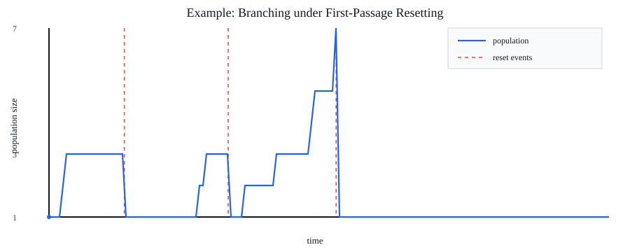

# branchingphage

Simulation of Branching under First-Passage Resetting.

## Model implemented

This repository includes a minimal Monte Carlo simulator for a one-dimensional branching diffusion process with first-passage resetting, using a Gillespie event-driven scheme on a spatial lattice:

- Particles start at `x0 > boundary`.
- Diffusive jumps and drift-driven jumps are sampled as continuous-time events.
- Branching is sampled as a Poisson event process with rate `branching_rate` per particle.
- If any particle reaches the boundary (`x <= boundary`), a global first-passage reset is triggered and the system restarts from a single particle at `x0`.

## Run

```bash
python /home/runner/work/branchingphage/branchingphage/fpr_branching.py --runs 1000 --seed 0
```

The CLI prints JSON with ensemble averages.
Use `--lattice-step` to control spatial discretization and `--dt` to control trajectory sampling resolution.

## Example figure

Generate a deterministic example figure (SVG) of one population trajectory with reset markers:

```bash
python /home/runner/work/branchingphage/branchingphage/make_example_figure.py
```

This writes:

- `/home/runner/work/branchingphage/branchingphage/figures/example_trajectory.svg`



## Test

```bash
python -m unittest /home/runner/work/branchingphage/branchingphage/test_fpr_branching.py
python -m unittest /home/runner/work/branchingphage/branchingphage/test_example_figure.py
```
